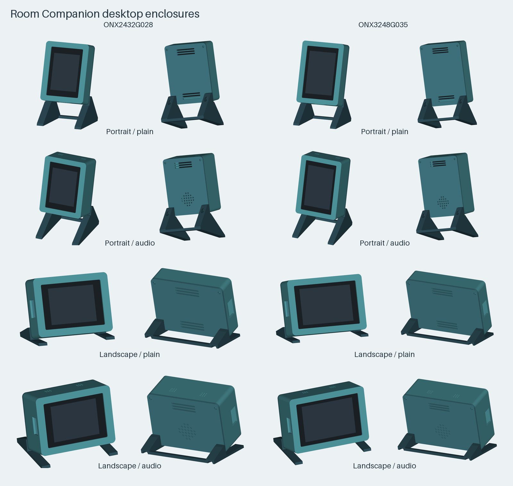

# Room Companion desktop enclosures

Print a matching **bezel**, **back**, and **stand** for your panel. Both
orientations lean back 16°. The audio versions use the same front outline as
the plain cases. The microphone vents through the top edge, and the Nextion
BOX Speaker mounts behind the rear grille.



| Panel | Orientation | Version | STL files | Preview |
| --- | --- | --- | --- | --- |
| ONX2432G028 (2.8″) | Portrait | Plain | [Bezel](stl/onx2432g028-portrait-plain-bezel.stl) · [Back](stl/onx2432g028-portrait-plain-back.stl) · [Stand](stl/onx2432g028-portrait-plain-stand.stl) | [Front and rear](renders/onx2432g028-portrait-plain.png) |
| ONX2432G028 (2.8″) | Portrait | Mic + speaker | [Bezel](stl/onx2432g028-portrait-audio-bezel.stl) · [Back](stl/onx2432g028-portrait-audio-back.stl) · [Stand](stl/onx2432g028-portrait-audio-stand.stl) | [Front and rear](renders/onx2432g028-portrait-audio.png) |
| ONX2432G028 (2.8″) | Landscape | Plain | [Bezel](stl/onx2432g028-landscape-plain-bezel.stl) · [Back](stl/onx2432g028-landscape-plain-back.stl) · [Stand](stl/onx2432g028-landscape-plain-stand.stl) | [Front and rear](renders/onx2432g028-landscape-plain.png) |
| ONX2432G028 (2.8″) | Landscape | Mic + speaker | [Bezel](stl/onx2432g028-landscape-audio-bezel.stl) · [Back](stl/onx2432g028-landscape-audio-back.stl) · [Stand](stl/onx2432g028-landscape-audio-stand.stl) | [Front and rear](renders/onx2432g028-landscape-audio.png) |
| ONX3248G035 (3.5″) | Portrait | Plain | [Bezel](stl/onx3248g035-portrait-plain-bezel.stl) · [Back](stl/onx3248g035-portrait-plain-back.stl) · [Stand](stl/onx3248g035-portrait-plain-stand.stl) | [Front and rear](renders/onx3248g035-portrait-plain.png) |
| ONX3248G035 (3.5″) | Portrait | Mic + speaker | [Bezel](stl/onx3248g035-portrait-audio-bezel.stl) · [Back](stl/onx3248g035-portrait-audio-back.stl) · [Stand](stl/onx3248g035-portrait-audio-stand.stl) | [Front and rear](renders/onx3248g035-portrait-audio.png) |
| ONX3248G035 (3.5″) | Landscape | Plain | [Bezel](stl/onx3248g035-landscape-plain-bezel.stl) · [Back](stl/onx3248g035-landscape-plain-back.stl) · [Stand](stl/onx3248g035-landscape-plain-stand.stl) | [Front and rear](renders/onx3248g035-landscape-plain.png) |
| ONX3248G035 (3.5″) | Landscape | Mic + speaker | [Bezel](stl/onx3248g035-landscape-audio-bezel.stl) · [Back](stl/onx3248g035-landscape-audio-back.stl) · [Stand](stl/onx3248g035-landscape-audio-stand.stl) | [Front and rear](renders/onx3248g035-landscape-audio.png) |

## Print and assemble

1. Import the three matching STLs in **millimetres**. They are oriented with
   the bezel's face, the back cover's exterior, and the stand's desk face on
   the build plate. A 0.4 mm nozzle, 0.2 mm layers, and three walls in PETG are
   a starting point. Check the USB cutout in the slicer and use local bridge
   support if needed. Keep the glass pocket clear of brim and elephant's foot.
2. Test-fit the display through the back of the bezel and plug in your cable.
   Apply about 0.25 mm of removable double-sided tape along the bezel's
   inner lip, where it meets the black border of the glass. Keep the active
   area free. Press only around the edge of the glass.
3. On an audio version, center the [Nextion Dual MIC Board](https://itead.cc/product/nextion-dual-mic-board/)
   inside the top wall, behind the display. The 48 × 14 mm mounting area is
   centered on the two grilles. Face both acoustic ports up toward the grilles
   and fasten the board with thin foam tape clear of the ports and flex
   connector. Route the flex down to MIC_PDM without a sharp fold. Point the [Nextion BOX Speaker](https://itead.cc/wp-content/uploads/2022/03/Box-Speaker-Dimension.pdf)
   into the back cover's grille with a thin foam gasket around the opening.
   Use two M2 × 6 mm thread-forming screws in the printed pilot holes.
   Check that the speaker seats against the gasket before tightening. Connect
   it to SPK and tuck the wires away from the cover rim and USB socket.
4. Seat the cover. Start two M3 × 10 mm thread-forming screws in the upper
   holes. Hold the stand against the lower cover and fasten both together with
   two M3 × 16 mm thread-forming screws. Hand-tighten the printed bosses.
   The BOOT and RESET buttons and microSD slot are reached by removing the cover.
5. Set the screen orientation in Room Companion. In landscape the connector
   exits at the left when looking at the display. In portrait it exits between
   the stand's feet. Route the lead out between the feet under the case.

## USB-C clearance

The portrait stand lifts the case and leaves the connector's insertion path
open through the desk-side edge. Both orientations use a 21 × 12 mm shell
opening. The glass extends about 1.9 mm past the socket on the 2.8″ and 7.4 mm
on the 3.5″. Choose a straight plug that fits the tested CAD envelope.

- **2.8″** — 18 × 10 mm plug body up to 31 mm long, starting 1.5 mm from
  the socket face when seated.
- **3.5″** — the plug neck can be up to 12.5 mm wide and 5.5 mm thick
  between 1.5 and 5.5 mm from the socket face. The wider 18 × 10 mm
  part of the plug can start 5.5 mm from the socket face. A plug with a
  thick molded shoulder right behind the metal tip can hit the display.

[Portrait clearance render with the nominal plug envelope](renders/portrait-usb-detail.png)

## CAD sources and validation

[enclosure.py](enclosure.py) is the parametric source. It uses the glass
outline, front datum, and USB-C receptacle position from the manufacturer
[ONX2432G028 drawings and STEP](https://github.com/OpenNextion/OpenNextion-SKU-ONX2432G028/tree/main/Drawings)
and [ONX3248G035 drawings and STEP](https://github.com/OpenNextion/OpenNextion-SKU-ONX3248G035/tree/main/Drawings).
The rounded desktop format and the need for extra portrait plug access were
informed by the
[OpenNextion desktop shell](https://makerworld.com/en/models/3211049-open-nextion-3-5-esp32-s3-display-desktop-shell#profileId-3634703)
and [horizontal/vertical desktop case](https://makerworld.com/en/models/3509686-onx3248g035-desktop-case-horizontal-vertical#profileId-4010326).

Generate STLs with CadQuery. The PNG renderer uses VTK (included with CadQuery) and Pillow. For the optional fit
check, save the official STEP files as `ONX2432G028.stp` and
`ONX3248G035.stp` in a separate directory.

```sh
python -m pip install 'cadquery==2.8.0' 'pillow>=10.1'
python hardware/enclosures/enclosure.py --previews --check-step /path/to/board-steps
python hardware/enclosures/render.py
```

All eight variants were checked against the manufacturer STEP files and the
nominal USB-C overmold. The STLs were checked for closed, single-part meshes.
Fit, screw retention, cable flexibility, print settings, and audio performance
still need to be verified on a physical print.
